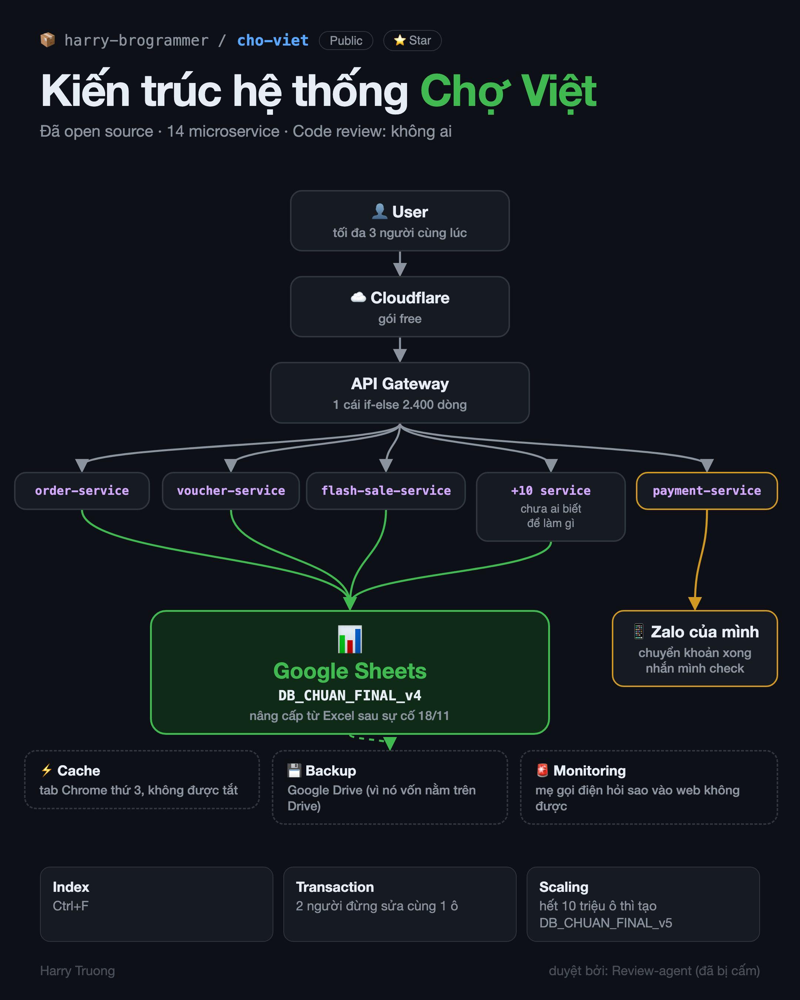

# 🛍 Chợ Việt

Sàn thương mại điện tử vibe code bởi 6 AI agent. Giống Shopee nhưng ít bug hơn (theo PM-agent).

     

## Vì sao open source?

Sau bài giới thiệu Chợ Việt, anh em vào chửi quá trời: "code AI viết chắc lỗi đầy", "database đâu", "chắc gì có thật".

Mình suy nghĩ 3 ngày (thật ra là agent suy nghĩ, mình ngủ). Cách tốt nhất để hết bị chửi là cho mọi người xem code. Xem rồi sẽ hiểu.

Đây cũng là lần đầu mình dùng git. Trước giờ code lưu trên Google Drive.

## Số liệu

| | |
|---|---|
| Microservice | 14 |
| Dòng code | 184.920 |
| Dòng mình đọc được | 0 |
| User đồng thời (load test) | 2.000.000 (trên 3 tab Chrome) |
| User đồng thời (thật) | 4 (mẹ mình, 2 bạn, Googlebot) |
| Tiền token | $523,41 (chưa tính tiền điện) |
| Vốn cần gọi | $2.000.000 (đã gọi được: 0đ) |

## Kiến trúc hệ thống



| Thành phần | Công nghệ |
|---|---|
| Database | Google Sheets. Mỗi microservice 1 tab |
| Index | Ctrl+F |
| Transaction | 2 người đừng sửa cùng 1 ô |
| Message queue | Google Form. Kết quả đổ về Sheet, sáng mình xử lý |
| Cache | Tab Chrome thứ 3. Không được tắt |
| Thanh toán | Chuyển khoản rồi nhắn Zalo mình. Service duy nhất chưa sập lần nào, vì nó là mình |
| Monitoring | Mẹ mình gọi điện hỏi "sao con vào web không được" |
| CI/CD | Agent push thẳng lên `main`, không ai review |
| Scaling | Hết 10 triệu ô thì tạo `DB_CHUAN_FINAL_v5` |

## Cài đặt

```bash
git clone https://github.com/harry-brogrammer/cho-viet
cd cho-viet
npm install        # khoảng 40 phút, 1.847 package, 312 cảnh báo. Kệ nó
cp .env.example .env
npm run dev
```

Sau đó:

1. Nhắn Zalo mình xin quyền edit Google Sheet
2. Mở thêm 2 tab Chrome để có cache
3. Không tắt máy

## Roadmap

- [x] Làm giống Shopee
- [x] Ít bug hơn Shopee (theo PM-agent)
- [x] Nâng cấp database từ Excel lên Google Sheets
- [x] Open source
- [ ] Đọc thử 1 dòng code
- [ ] User thật thứ 5
- [ ] Chuyển database sang PostgreSQL (agent nói khó, để sau)

## Đóng góp

Xem [CONTRIBUTING.md](CONTRIBUTING.md). Tóm tắt: gửi PR thoải mái, agent tự merge.

## License

MIT. Code do AI viết nên mình cũng không chắc nó là của ai.

---

Làm bằng ❤️ và $523 tiền token bởi Harry Truong.
